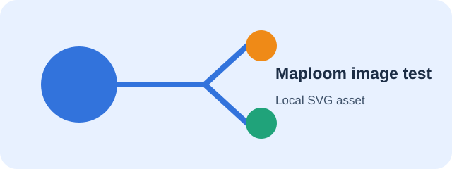

# Obsidian native syntax acceptance test

## Wikilinks

- Standard internal link: [[Maploom-Linked-Note]]
- Aliased internal link: [[Maploom-Linked-Note|Readable link label]]
- Heading link: [[Maploom-Linked-Note#Linked heading|Open the linked heading]]

## Embedded note

The following note should render inline using Obsidian's native embed handling.

![[Maploom-Linked-Note]]

## Embedded image

The SVG should render as an embedded image, not as a broken link.

![[maploom-fixture.svg]]

## Markdown image

The same SVG should also render through ordinary Markdown image syntax.

